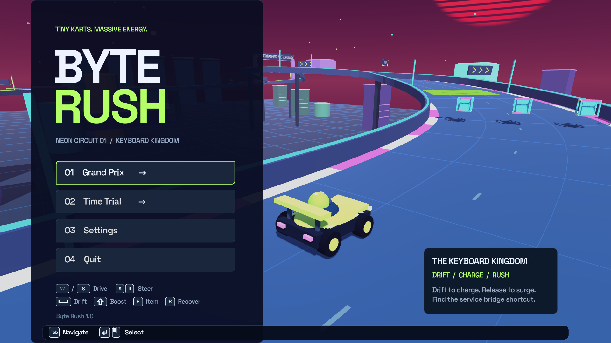

# Byte Rush

A colorful 3D arcade kart racer set inside a computer. Drift through the Keyboard Kingdom, boost across the motherboard, and race past giant cooling fans.

**Version 1.0 · Godot 4.5.1 · GDScript · macOS**



## Features

- Three-lap Grand Prix against five rivals, plus solo Time Trial with saved personal bests.
- Three drift-boost tiers, a rechargeable capacitor, collectible items, ramps and a service-bridge shortcut.
- Keyboard/mouse and PlayStation, Xbox, Nintendo and generic controller support, with adaptive button icons.
- Resolution settings up to 3840 × 2160, fullscreen, steering sensitivity, master volume and antialiasing.
- Procedural track geometry, vehicles and effects, with original synthesized audio.

## Run from source

Install [Godot 4.5.1 Standard](https://github.com/godotengine/godot-builds/releases/tag/4.5.1-stable), import `project.godot` in the project manager, and press **F5**.

The project includes its runtime assets and needs no package installation or network connection to play. A separately supplied **Byte Rush.app** runs without the editor. macOS is the supported and tested desktop platform; other export targets have not been validated.

For command-line use, replace `godot` with your Godot executable if it is not on your PATH:

```sh
godot --headless --path . --import
godot --path .
```

On macOS the usual executable is `/Applications/Godot.app/Contents/MacOS/Godot`.

## Controls

| Action | Keyboard | PlayStation | Xbox | Nintendo |
| --- | --- | --- | --- | --- |
| Accelerate / brake | W / S or ↑ / ↓ | R2 / L2 | RT / LT | ZR / ZL |
| Steer | A / D or ← / → | Left stick | Left stick | Left stick |
| Drift | Space | × | A | B |
| Capacitor boost | Shift | R1 | RB | R |
| Use item | E | □ | X | Y |
| Recover | R | △ | Y | X |
| Pause | Escape | Options | Menu | + |
| Menu select / back | Enter / Escape | × / ○ | A / B | A / B |

Menus also support the mouse, Tab, arrow keys, controller sticks and D-pads. Button prompts switch with the active input device. See [the gameplay guide](docs/GAMEPLAY.md) for the full rules, settings and save locations.

## Test

Python 3.9 or newer runs the standard-library test runner:

```sh
python3 tools/test.py --godot /path/to/godot
```

It imports a fresh checkout, runs eight headless regression suites, then simulates complete races on every difficulty and in Time Trial. Logs go to the ignored `build/test-results/` folder. The same command runs in GitHub Actions on macOS. Native rendering, audio and physical-controller checks are described in [tests/README.md](tests/README.md).

## Build for macOS

Install the matching Godot **4.5.1 export templates** through **Editor → Manage Export Templates**, then run:

```sh
BYTE_RUSH_GODOT=/Applications/Godot.app/Contents/MacOS/Godot ./tools/build_macos.sh
```

The universal Apple Silicon/Intel app is written to `build/Byte Rush.app`. It is ad-hoc signed for local use. Public Developer ID distribution requires your own signing and notarization setup. Apps, engine downloads, export templates and release ZIP files are not tracked in this source repository.

## Project layout

| Folder | Contents |
| --- | --- |
| `scripts/` | Racing, physics, track generation, menus, input and display code |
| `scenes/` | Main game scene |
| `assets/` | Audio, font, icon, materials and shaders |
| `tests/` | Regression and rendered smoke-test programs |
| `tools/` | Build, test and audio-generation utilities |
| `docs/` | Gameplay, development notes and historical audits |
| `third_party/` | Godot licence and third-party notices |

See [CONTRIBUTING.md](CONTRIBUTING.md) for development guidance and [RELEASES.md](RELEASES.md) for the 0.x → 1.0 history.

## Licence

Original game code and procedural content are available under the [MIT licence](LICENSE). Space Grotesk uses the [SIL Open Font License](assets/fonts/OFL.txt). Godot and its dependencies retain their [own notices](third_party/). The original audio can be regenerated with `python3 tools/generate_audio.py`.
